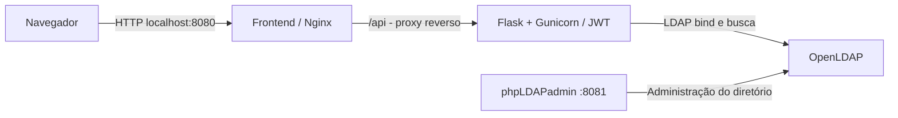
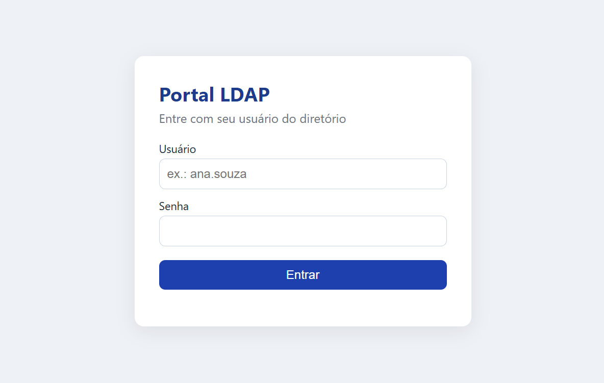
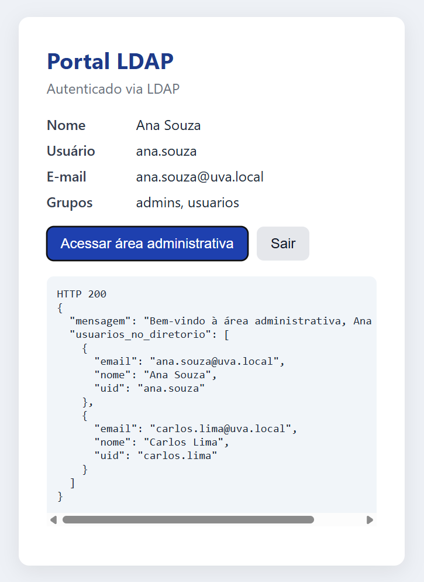
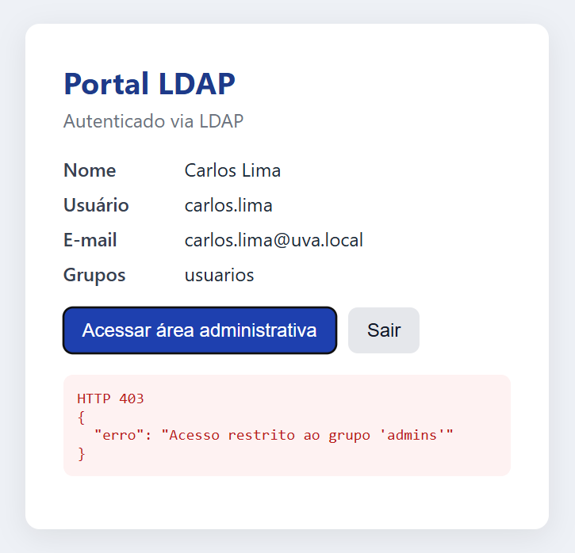

# Autenticação LDAP com Docker

**Backend de autenticação centralizada via OpenLDAP**, desenvolvido em **Python e Flask**, com emissão de tokens **JWT**, controle de acesso por grupos e infraestrutura em **Docker Compose**. O projeto inclui um frontend em HTML, CSS e JavaScript servido pelo Nginx.

> Projeto acadêmico individual de Desenvolvimento Backend — Engenharia de Software, Universidade Veiga de Almeida (2026). Ambiente demonstrativo para execução local; **não é uma configuração de produção**.

## Visão geral

Em vez de cadastrar senhas no banco da aplicação, a API pesquisa o usuário no diretório e valida sua senha realizando um *bind* LDAP. Após a autenticação, consulta os grupos do usuário e gera um JWT válido por 60 minutos. Algumas rotas exigem autorização adicional pelo grupo `admins`.

### Funcionalidades

- Autenticação com contas armazenadas no **OpenLDAP** (`ldap3`);
- Busca de usuário por `uid` com escape de filtros para reduzir risco de **LDAP injection**;
- Bloqueio de login com usuário ou senha em branco;
- Geração e verificação de **JWT** assinado com HS256;
- Autorização baseada nos grupos `admins` e `usuarios`;
- API REST com respostas HTTP **200, 401, 403 e 503** conforme o resultado;
- Frontend de login e painel de usuário, com proxy reverso via **Nginx**;
- **phpLDAPadmin** para administração visual do diretório;
- Dois segmentos de rede Docker, healthcheck do LDAP e persistência por volumes.

## Tecnologias

| Camada | Tecnologias |
| --- | --- |
| Backend | Python 3.12, Flask 3.0.3, Gunicorn, ldap3, PyJWT |
| Autenticação | OpenLDAP 1.5.0, diretório LDAP e grupos `groupOfNames` |
| Frontend | HTML5, CSS3, JavaScript (sem framework) |
| Servidor web | Nginx 1.27 Alpine |
| Infraestrutura | Docker e Docker Compose |
| Administração | phpLDAPadmin 0.9.0 |

## Arquitetura



O frontend e o backend compartilham a rede `frontnet`; o backend e o OpenLDAP compartilham a rede `backnet`. Assim, o frontend não acessa diretamente o LDAP. Leia [a documentação da arquitetura](docs/ARQUITETURA.md) para mais detalhes.

## Pré-requisitos

- Docker Desktop ou Docker Engine com plugin Docker Compose;
- Portas **8080**, **8081**, **5000** e **389** disponíveis no computador;
- Terminal (PowerShell, Bash ou equivalente).

> Não é necessário instalar Python, Flask ou LDAP no computador: os serviços são executados em containers.

## Executar localmente

**1.** Clone o repositório e entre na pasta:

```bash
git clone https://github.com/adolfo-araujo/ldap-auth-docker.git
cd ldap-auth-docker
```

**2.** Crie o arquivo de ambiente a partir do modelo:

```bash
# Linux / macOS
cp .env.example .env
```

No **PowerShell** do Windows, use:

```powershell
Copy-Item .env.example .env
```

Edite o arquivo `.env` e substitua **ambos** os valores: `LDAP_ADMIN_PASSWORD` e `JWT_SECRET`. Use uma chave JWT aleatória de pelo menos 32 caracteres. Para gerar uma com Python, se disponível:

```bash
python -c "import secrets; print(secrets.token_urlsafe(48))"
```

**3.** Inicie os serviços:

```bash
docker compose up -d --build
docker compose ps
```

**4.** Acesse os endereços locais:

| Serviço | Endereço |
| --- | --- |
| **Aplicação web** | http://localhost:8080 |
| phpLDAPadmin | http://localhost:8081 |
| API (healthcheck) | http://localhost:5000/api/health |

Para entrar no phpLDAPadmin, o DN administrativo é `cn=admin,dc=uva,dc=local` e a senha é a definida em seu `.env` na primeira inicialização do diretório.

### Usuários fictícios para demonstração

O arquivo [`ldap/bootstrap.ldif`](ldap/bootstrap.ldif) configura dois usuários **de laboratório** ao criar o volume do diretório pela primeira vez:

| Usuário | Senha demonstrativa | Grupos | Acesso administrativo |
| --- | --- | --- | --- |
| `ana.souza` | `Ana@2026` | `admins`, `usuarios` | Sim |
| `carlos.lima` | `Carlos@2026` | `usuarios` | Não (HTTP 403) |

**Atenção:** essas contas e senhas são dados públicos de exemplo, **não** devem ser usados com informações reais ou em um serviço exposto à internet.

## Endpoints

| Método | Rota | Descrição | Autenticação |
| --- | --- | --- | --- |
| `GET` | `/api/health` | Verifica disponibilidade da API e do LDAP | Não |
| `POST` | `/api/login` | Valida credenciais LDAP e retorna JWT | Usuário/senha |
| `GET` | `/api/me` | Retorna os dados do token válido | Bearer JWT |
| `GET` | `/api/admin` | Lista usuários do diretório | Bearer JWT + grupo `admins` |

Exemplo de login pelo **PowerShell**:

```powershell
$resposta = Invoke-RestMethod -Uri http://localhost:8080/api/login `
  -Method Post -ContentType "application/json" `
  -Body '{"username":"ana.souza","password":"Ana@2026"}'

$resposta.usuario
Invoke-RestMethod -Uri http://localhost:8080/api/me `
  -Headers @{ Authorization = "Bearer $($resposta.token)" }
```

Os testes esperados — login válido, credenciais incorretas e acesso negado a usuário comum — estão descritos em [docs/TESTES.md](docs/TESTES.md).

## Telas do projeto

As capturas abaixo foram extraídas do relatório acadêmico do próprio projeto.

**Tela de autenticação**



**Painel após login autorizado**



**Acesso administrativo negado (HTTP 403)**



## Estrutura dos arquivos

```text
ldap-auth-docker/
├── backend/
│   ├── app.py                 # API REST, LDAP, JWT e autorização
│   ├── requirements.txt       # Bibliotecas Python
│   ├── Dockerfile
│   └── .dockerignore
├── frontend/
│   ├── index.html             # Tela de login e painel
│   ├── app.js                 # Requisições e token de sessão
│   ├── style.css
│   ├── nginx.conf             # Proxy /api para o backend
│   ├── Dockerfile
│   └── .dockerignore
├── ldap/
│   └── bootstrap.ldif        # Usuários e grupos fictícios
├── docs/
│   ├── screenshots/
│   ├── ARQUITETURA.md
│   ├── TESTES.md
│   └── PUBLICACAO.md
├── docker-compose.yml
├── .env.example               # Modelo público, sem segredos reais
├── .gitignore
└── README.md
```

## Logs, parada e reinicialização

```bash
docker compose logs -f backend
docker compose down
```

Se precisar **apagar os usuários e volumes do LDAP** e repetir o bootstrap, use (atenção: destrói os dados armazenados):

```bash
docker compose down -v
docker compose up -d --build
```

## Observações de segurança

Este é um laboratório local. O LDAP funciona sem TLS e o phpLDAPadmin utiliza HTTP. As portas do host ficam restritas a `127.0.0.1` nesta versão preparada para publicação. **Não publique esses serviços diretamente na internet.**

- As credenciais reais devem ficar no `.env`, que está excluído do Git via `.gitignore`.
- O arquivo `.env.example` contém apenas valores ilustrativos, que precisam ser substituídos.
- A API exige um `JWT_SECRET` de pelo menos 32 caracteres e não usa mais uma chave padrão.
- Os grupos são copiados para o JWT; mudanças de permissão não invalidam tokens já emitidos até sua expiração (60 minutos).
- Para uso em produção, seriam necessários LDAPS/StartTLS, HTTPS, contas de serviço com privilégios mínimos, gerenciamento de segredos, controles de exposição e revisão adicional de segurança.

## Autoria

Projeto acadêmico individual desenvolvido por **João Adolfo Martins Araújo**, no curso de Engenharia de Software da Universidade Veiga de Almeida.

Para orientações de publicação, consulte [docs/PUBLICACAO.md](docs/PUBLICACAO.md).
